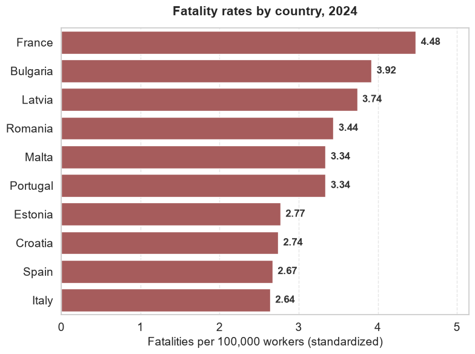
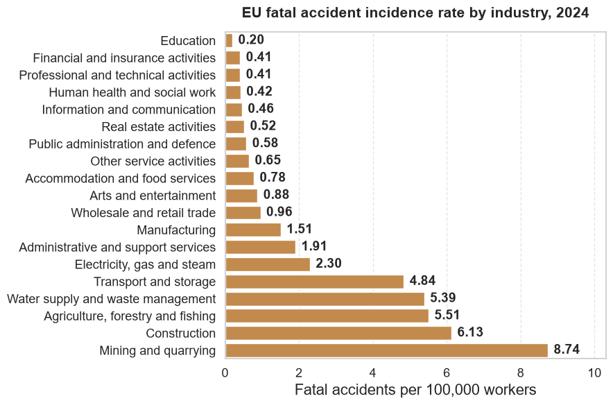
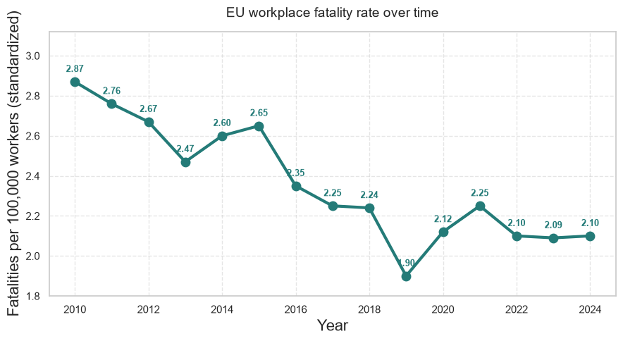
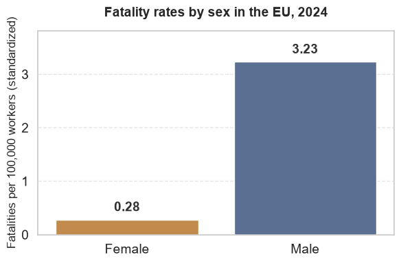
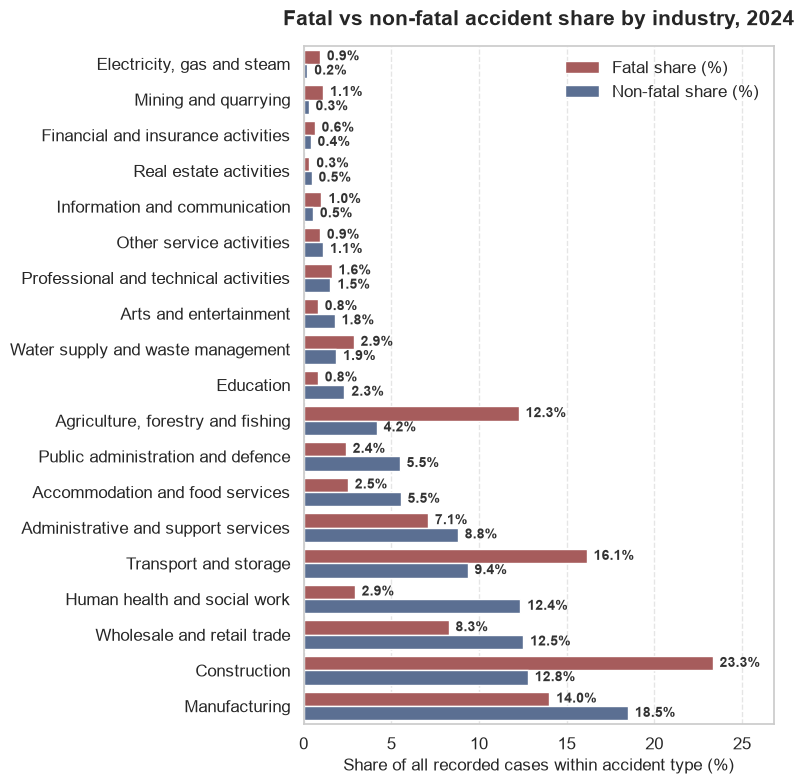
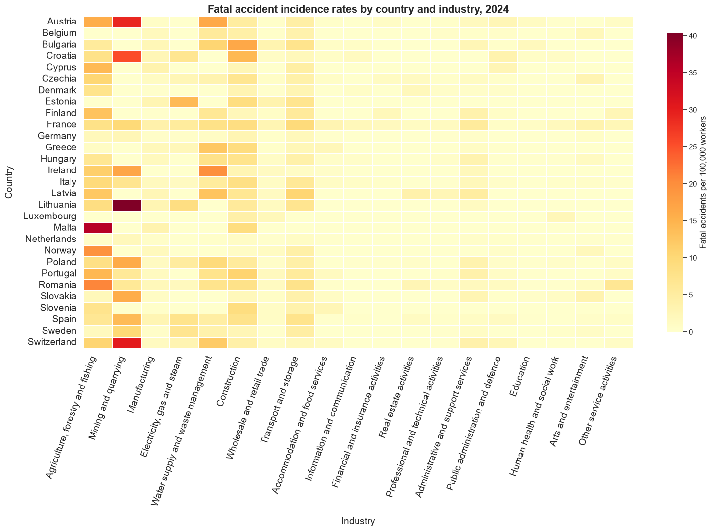
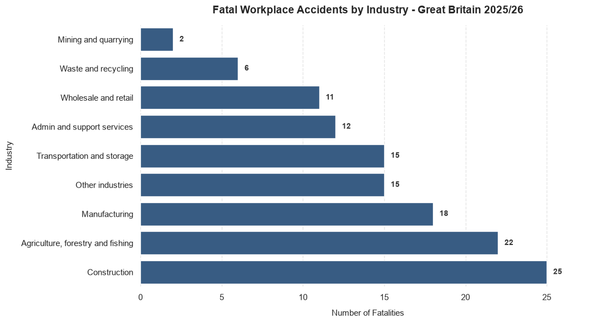
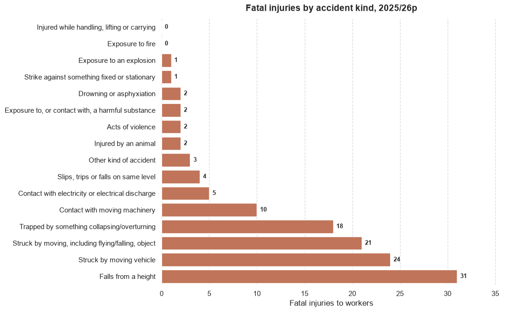
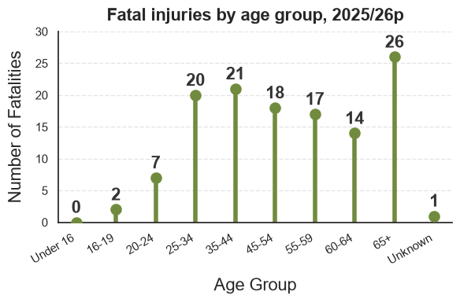

# Fatal Workplace Accidents: Europe and Great Britain

A Python data-analysis project exploring fatal workplace accidents using public data from Eurostat and the UK Health and Safety Executive (HSE). The notebooks clean and reshape the source tables, perform basic data-quality checks, and create charts for comparing accident rates and counts across time, countries, industries, age groups, and accident types.

## Project Highlights

- Compare Eurostat fatal-accident incidence rates across countries and industries.
- Explore European workplace fatality trends over time and by sex.
- Compare fatal and non-fatal accident data by industry.
- Review HSE fatal-injury counts for Great Britain by industry, accident kind, and age group.
- Export HSE workbook sheets to CSV and run read-only data-quality checks.

The Eurostat notebook selects the latest year available across the datasets used in its comparisons. HSE figures labelled `2025/26p` are preliminary in the source workbook. These analyses are descriptive and do not establish causes of workplace accidents.

## Visualizations

### Eurostat

|  |  |
| --- | --- |
|  |  |
|  |  |
|  |  |

### Health and Safety Executive (HSE)

|  |  |
| --- | --- |
|  |  |
|  | |

## Repository Structure

```text
.
├── data/
│   ├── raw/
│   │   ├── data_eurostat/       # Eurostat TSV files
│   │   └── data_hse/            # HSE Excel workbooks
│   └── processed/
│       └── ridfatal_csv/        # CSV exports from the HSE fatal-injuries workbook
├── images/                      # Chart images shown above
├── notebooks/
│   ├── eurostat_fatal.ipynb     # Eurostat cleaning, analysis, and charts
│   ├── hse_fatal.ipynb          # HSE workbook processing, checks, and charts
│   ├── requirements.txt
│   └── download/                # Source-data download and loading scripts
└── README.md
```

## Data Sources

- [Eurostat health and safety at work datasets](https://ec.europa.eu/eurostat/web/health-and-safety-at-work/database): fatal accidents by economic activity (`hsw_n2_02`), standardised fatal-accident incidence rates (`hsw_mi01`), and non-fatal accidents (`hsw_n2_01`).
- [HSE statistics tables](https://www.hse.gov.uk/statistics/tables.htm): fatal injury tables and supporting workbook data.

The source data is distributed by Eurostat and HSE. Check each source for definitions, coverage, revisions, and reporting notes before interpreting or reusing the figures.

## Getting Started

Use Python 3.9 or newer. From the repository root, create and activate a virtual environment, then install the notebook dependencies:

```bash
python -m venv .venv
```

Windows PowerShell:

```powershell
.venv\Scripts\Activate.ps1
python -m pip install pandas numpy matplotlib seaborn openpyxl requests jupyter
```

macOS or Linux:

```bash
source .venv/bin/activate
python -m pip install pandas numpy matplotlib seaborn openpyxl requests jupyter
```

Open the notebooks in Jupyter or Visual Studio Code with the Jupyter extension, select the environment above as the kernel, and run the cells in order. The Eurostat notebook reads files from `data/raw/data_eurostat/`; it can download `hsw_n2_01.tsv` if that file is missing.

### HSE Notebook Path

`hse_fatal.ipynb` currently contains a local absolute path to `ridfatal.xlsx`. After cloning the repository, update the `file_path` variable near the start of the notebook to point to `data/raw/data_hse/ridfatal.xlsx` in your local clone before running the HSE cells. The download scripts also accept an output-folder argument; for example, from the repository root:

```bash
python notebooks/download/download_files_eurostat.py data/raw/data_eurostat
python notebooks/download/download_files_hse.py data/raw/data_hse
```

## Dependencies

The notebooks use pandas, NumPy, Matplotlib, Seaborn, openpyxl, and Requests. The `notebooks/requirements.txt` file currently contains notebook install commands; the package list above is provided for setting up a fresh environment.
